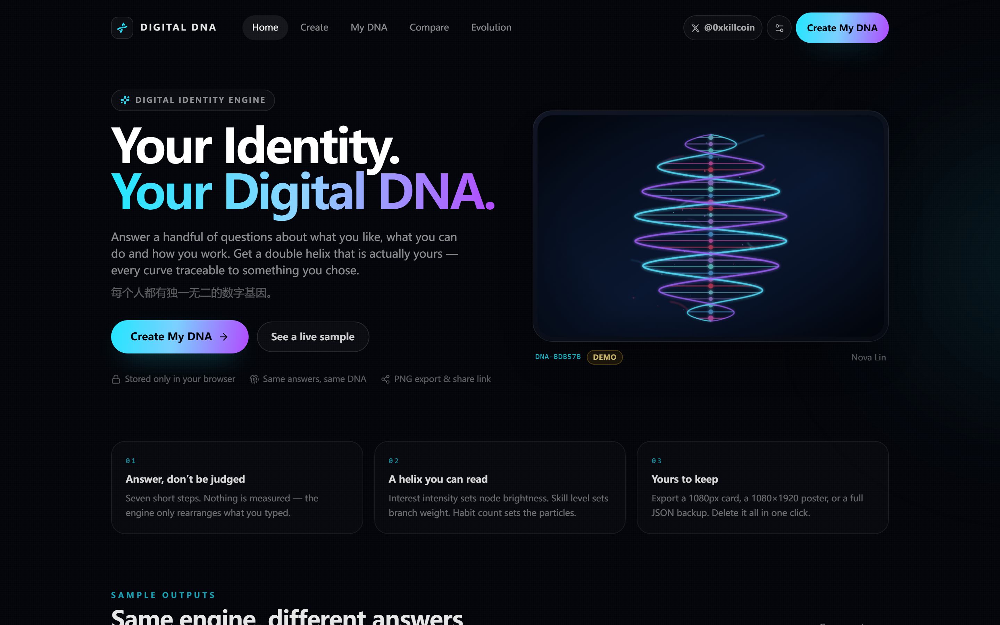
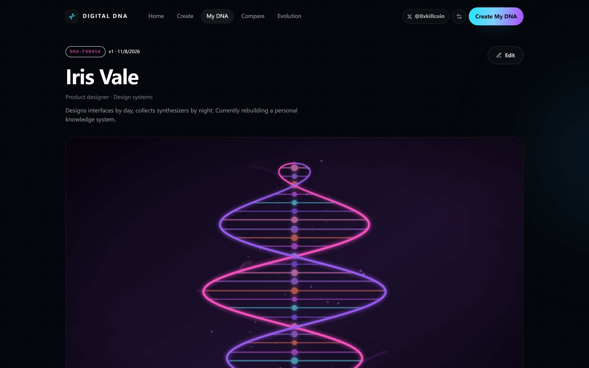
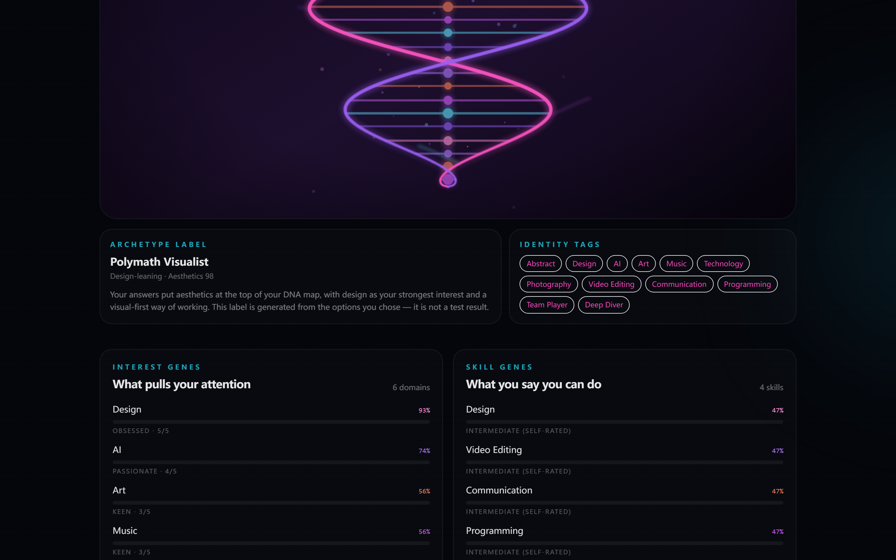
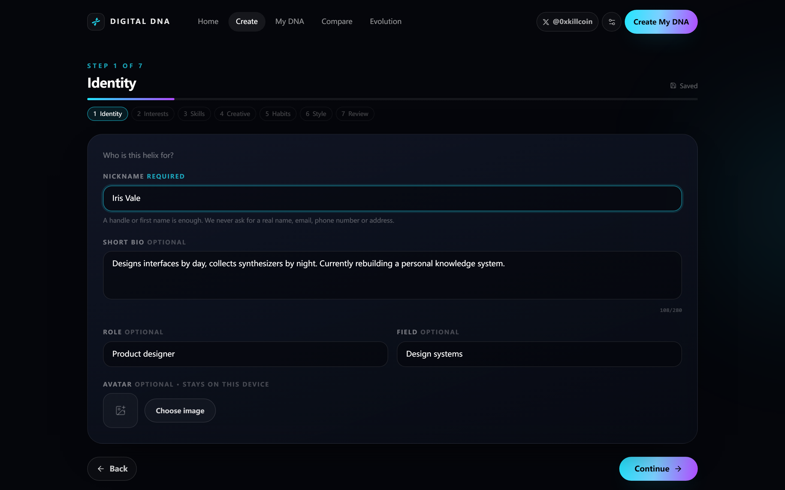
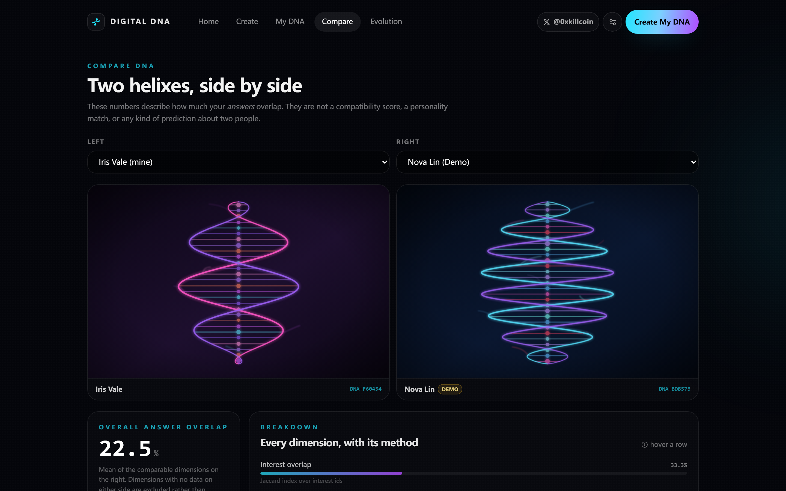
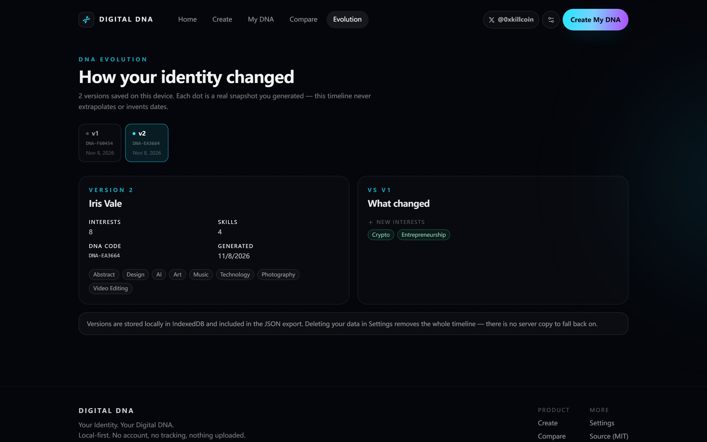
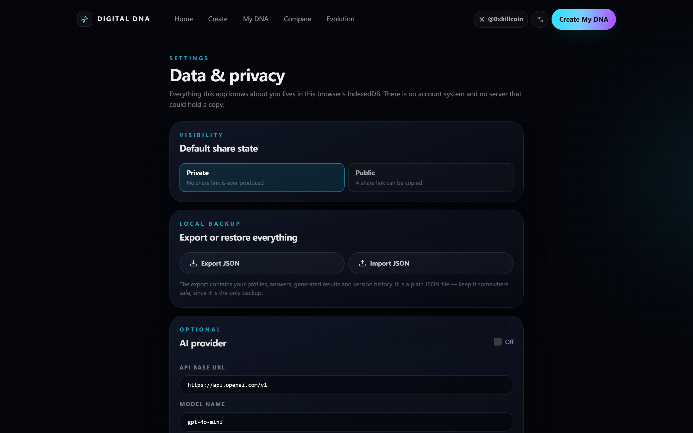
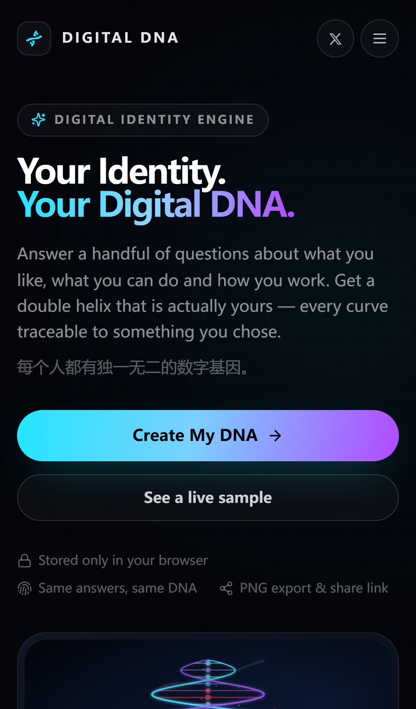
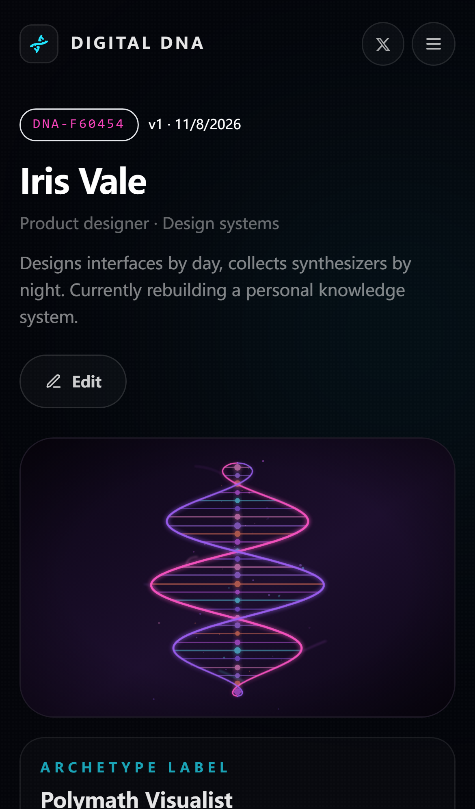
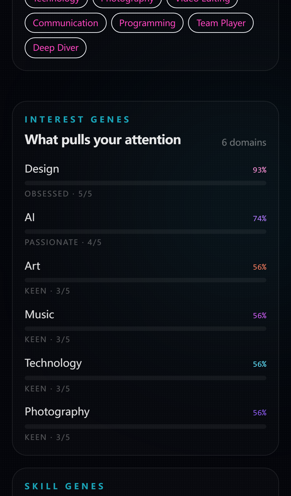

<div align="center">

# 🧬 Digital DNA · 数字基因实验室

**Your Identity. Your Digital DNA.**
*每个人都有独一无二的数字基因。*

Answer a handful of questions about what you like, what you can do and how you work —
get a deterministic, data-driven **double helix** you can download and share.

[**Live demo →**](https://iiiiiiiiiiiiikk.github.io/digital-dna/) ·
[Report a bug](https://github.com/iiiiiiiiiiiiiKK/digital-dna/issues) ·
[Author on X](https://x.com/0xkillcoin)

[](./LICENSE)
[](#-testing)
[](#-privacy-design)
[](#-data-structure)



</div>

---

## 📖 Table of contents

- [What it is](#-what-it-is)
- [Screenshots](#-screenshots)
- [Features](#-features)
- [How the engine works](#-how-the-engine-works)
- [Similarity maths (Compare)](#-similarity-maths-compare)
- [Tech stack](#-tech-stack)
- [Architecture](#-architecture)
- [Local development](#-local-development)
- [Testing](#-testing)
- [Data structure](#-data-structure)
- [Privacy design](#-privacy-design)
- [Deployment](#-deployment)
- [Known limits](#-known-limits)
- [Roadmap](#-roadmap)
- [License](#-license)
- [中文说明](#-中文说明)

---

## ✨ What it is

Digital DNA is a **digital identity generator and visualisation lab**.

You answer seven short steps about your interests, skills, creative habits and visual taste.
The engine turns those answers into:

1. a **personal digital identity profile**,
2. a **double-helix artwork** where every curve traces back to something you chose,
3. **feature distributions** (interest genes / skill genes),
4. an **interest ↔ skill star map**,
5. **identity tags**,
6. a **shareable identity card** (PNG, square + story poster),
7. a **public digital page** you can send to anyone.

### What it is *not*

> This is **not** a personality test, **not** an MBTI-style classifier, and **not** a psychological
> assessment. Nothing here infers your intelligence, mental state or "true self".

Every number on the result page is a **documented arithmetic transform** of an option you picked.
Skill levels are *your own self-ratings*, displayed with that wording everywhere. The
"archetype label" is a word-assembly from your strongest answers, and the UI says so.

If a value cannot be traced to an answer, it does not exist in this product.

---

## 📸 Screenshots

All screenshots are captured from the real production build by
[`scripts/screenshots.mjs`](./scripts/screenshots.mjs) — no mock-ups, no stock images.

| | |
|---|---|
| **Result page** | **DNA analysis** |
|  |  |
| **Creation wizard** | **Compare two DNAs** |
|  |  |
| **DNA Evolution** | **Settings &amp; privacy** |
|  |  |

<div align="center">

**Mobile (iPhone 13, WebKit)**





</div>

---

## 🚀 Features

### Creation
- **Seven-step wizard** with a progress rail, back navigation, per-step validation and auto-saved drafts.
- **20 interest domains** with 1–5 intensity per item, plus **custom entries**.
- **12 skills** with Beginner → Intermediate → Advanced → Expert self-ratings, plus custom skills.
- **Creative questions** in plain language (what you make, solo vs team, explore vs deepen, how you think, pace).
- **Digital habits** across platforms, tools, content, products and daily activity.
- **8 visual styles**: Cyberpunk, Minimal, Futuristic, Retro, Abstract, Organic, Neon, Monochrome.
- Optional avatar, downscaled in-browser to 256 px and stored locally only.

### The DNA engine
- **Deterministic by construction** — same answers, byte-identical output. Verified by tests and by an
  end-to-end test that deletes all data and rebuilds it.
- **Fully transparent** — the mapping table and the exact formulas are rendered in the UI
  (*"How this was calculated"*).
- **Identity number** `DNA-XXXXXX`, derived from a canonical hash of your answers only.
- **Version history** — every generation is a saved snapshot, diffed on the Evolution page.

### Visualisation
- **SVG double helix** built from a pure geometry module (`src/lib/helix.ts`) shared by the screen,
  the export pipeline and the tests.
- Rung colour = interest domain · node size/brightness = intensity · branch count = skill count ·
  branch thickness = self-rated level · particle density = habit count · braid/twist = creative answers.
- **Radar chart** (8 derived dimensions), **ring distribution**, **gene bars**, **tag cloud**,
  **bipartite interest↔skill association graph**.
- Charts are SVG with no chart library, so the same markup re-renders at export resolution.

### Sharing
- **1080×1080 square card** and **1080×1920 story poster**, rendered at **2×** (2160 px) for retina.
- Export is a self-contained SVG → canvas pipeline using **system fonts only**, so text never shifts,
  clips or falls back to a missing webfont.
- **Public share link** that works on a static host with no backend.
- **Private by default**: a private profile produces *no link at all*.

### Compare &amp; Evolution
- Compare against another profile or one of two clearly-labelled **Demo** profiles.
- Nine documented similarity dimensions (Jaccard, weighted Jaccard, mean-absolute-difference).
- Correct handling of empty sets — "no data", never a fake 100 %.
- Evolution timeline with per-version diffs: interests added/removed, skill level changes,
  intensity changes, tag changes.

### Data ownership
- 100 % **Local-first**: IndexedDB via Dexie, no account, no server, no analytics.
- **JSON export / import** of profiles, versions and results.
- **Delete everything** in one confirmed click.

### Optional AI
- Works with any **OpenAI-compatible** endpoint and your own key.
- Key lives only in your browser's IndexedDB; the request goes from your browser straight to the
  endpoint you typed.
- Explicit per-session consent before the first call, with the exact destination shown.
- **All core features work with no key configured** — verified by an end-to-end test.

### Author &amp; mobile
- The author **𝕏 link → [x.com/0xkillcoin](https://x.com/0xkillcoin)** in the header, the footer and the
  mobile menu, on every screen.
- **iPhone-first responsive work** audited across iPhone SE / 13 / 13 Pro Max / iPad mini / laptop /
  desktop — no horizontal overflow, no clipped content, and **no field below 16 px** (the iOS
  focus-zoom trap). See [`scripts/layout-audit.mjs`](./scripts/layout-audit.mjs).

---

## 🧪 How the engine works

The complete mapping, shown verbatim in the app:

| From (your input) | To (visual or numeric output) |
|---|---|
| Interest domain | Helix main hue and rung colour |
| Interest intensity (1–5) | Rung node size and brightness |
| Number of skills | Number of side branches |
| Self-rated skill level | Branch thickness and gene percentage |
| Creative answers | Helix shape: braid, turns, amplitude |
| Digital habits | Ambient particle distribution |
| Visual preference | Overall rendering style and palette |
| All answers (canonicalised) | DNA identity number and geometry seed |

**Formulas** (also rendered in the UI):

```
interest% = round( 90 × (i / 5) + 10 × (i / 5) × min(n, 20) / 20 )
             i = your 1–5 intensity, n = how many domains you picked

skill%    = round( 92 × level + 8 × (level / 100) × min(m, 15) / 15 )
             level = 25 / 50 / 75 / 100 for Beginner / Intermediate / Advanced / Expert

seed      = FNV-1a-32( canonical JSON of your answers )
dnaCode   = "DNA-" + first 6 hex characters of FNV-1a-64( canonical JSON )
```

Canonicalisation sorts interests, skills and every habit list by id, and drops all local metadata
(profile id, salt, timestamps, visibility) — so two people who answer identically get the same DNA
number, and the number can be recomputed by anyone from the visible answers.

Geometry is then derived deterministically:

```ts
// src/lib/engine.ts → buildHelix()
rungs         = 18 + min(interests, 14) + min(skills, 12)
turns         = 1.6 + min(skills, 12) × 0.11 + (exploration === 'explore' ? 0.4 : 0)
branchCount   = min(4 + skills, 26)
branchWeight  = 1 + (meanSkillLevel / 100) × 3.4
particleCount = min(24 + habits × 3, 160)
braid         = solo 0.82 · team 0.62 · hybrid 0.72
```

There is **no `Math.random()`** anywhere in the derived pipeline. Jitter comes from a seeded
mulberry32 PRNG so the ladder looks organic but is stable.

---

## 📐 Similarity maths (Compare)

Compare reports **answer overlap**, never "compatibility". Nine dimensions, each with its method
displayed next to the number:

| Dimension | Method |
|---|---|
| Interest overlap | Jaccard index over interest ids |
| Interest intensity match | Weighted Jaccard (Ruzicka) over 1–5 intensities |
| Interest profile distance | 1 − mean absolute difference of percentages |
| Skill overlap | Jaccard index over skill ids |
| Skill level match | 1 − mean absolute difference of skill percentages |
| Creative answers match | Share of identical answers across 5 questions |
| Digital habit overlap | Mean Jaccard across 5 habit categories |
| Visual preference | Exact style equality |
| Tag overlap | Jaccard over generated tags |

Edge cases are handled explicitly and covered by tests:

- **two empty sets → `null` ("no data")**, never 100 % — "we both said nothing" is not agreement;
- **one empty set → 0**, never a divide-by-zero;
- items present on only one side contribute their full difference, so a profile with many extra
  genes is correctly reported as dissimilar;
- categorical answers score **exactly 0 or 100** — partial credit would be meaningless.

---

## 🧱 Tech stack

| Layer | Choice | Why |
|---|---|---|
| UI | React 18 + TypeScript (strict) | Typed, componentised, no `any` escapes in domain code |
| Build | Vite 5 | Fast, tiny config, good static output |
| Styling | Tailwind CSS 3 | Design tokens in one file; no runtime CSS-in-JS cost |
| State | Zustand 5 | ~1 kB store, no provider tree |
| Storage | Dexie 4 (IndexedDB) | Local-first with real transactional reads |
| Motion | Framer Motion 11 | Entrances only; `prefers-reduced-motion` respected |
| Icons | Lucide React | Tree-shakeable, MIT |
| Routing | React Router 6 (HashRouter) | Deep links work on static hosts; share payload never leaves the fragment |
| Graphics | Hand-written SVG + Canvas | No chart library; same geometry reused for export |
| Tests | Vitest + Playwright | Unit determinism + real-browser E2E on desktop and iPhone |

**Licenses:** all runtime dependencies are MIT or ISC — compatible with this project's MIT license.
No GPL/AGPL code is bundled.

---

## 🗺 Architecture

```
src/
├─ lib/                     ← framework-free domain logic (100 % unit-testable)
│  ├─ types.ts              Domain types
│  ├─ catalog.ts            Option catalogs and labels
│  ├─ hash.ts               FNV-1a 32/64, stable stringify, seeded PRNG
│  ├─ profile.ts            Canonical answer payload, validation, defaults
│  ├─ engine.ts             The DNA engine: palette, genes, dimensions, helix params
│  ├─ helix.ts              Pure SVG geometry (shared by render + export + tests)
│  ├─ similarity.ts         Jaccard / weighted Jaccard / MAD similarity
│  ├─ export.ts             SVG card builder + PNG rasteriser
│  ├─ share.ts              URL-fragment share payload encode/decode
│  ├─ ai.ts                 Optional OpenAI-compatible client
│  ├─ db.ts                 Dexie schema, repositories, JSON import/export
│  └─ demo.ts               Two authored Demo profiles (labelled everywhere)
├─ components/
│  ├─ dna/                  DnaHelix, RadarChart, RingChart, GeneBars,
│  │                        TagCloud, AssociationGraph, ShareExportPanel, AiPanel
│  ├─ engine/               EngineExplainer (the transparency panel)
│  ├─ layout/               SiteHeader, SiteFooter, ErrorBoundary
│  ├─ ui/                   Controls, Primitives
│  └─ icons/                XIcon (+ the author URL constant)
├─ pages/                   Home, Wizard (+ wizard steps), Generate, DnaResult,
│                           ShareView, Compare, Evolution, Settings, NotFound
├─ store/useApp.ts          Zustand store (single profile focus, draft autosave)
├─ test/                    Vitest suites
└─ index.css                Tailwind layers + design system + iOS safe areas
e2e/app.spec.ts             Playwright: 12 scenarios × 2 browsers
scripts/                    Screenshot capture + responsive layout audit
```

Key structural decision: **all domain logic is pure and lives in `src/lib`**. React never computes a
DNA value; it only renders one. That is what makes determinism testable and the export pixel-identical
to the screen.

---

## 💻 Local development

```bash
git clone https://github.com/iiiiiiiiiiiiiKK/digital-dna.git
cd digital-dna
npm install

npm run dev        # http://localhost:5173
npm run build      # production build → dist/
npm run preview    # serve the production build
```

**Requirements:** Node 18+ (developed on Node 24), npm 9+.
No API keys, no database, no environment variables needed.

### Scripts

| Script | What it does |
|---|---|
| `npm run dev` | Vite dev server |
| `npm run build` | Type-check-free production build (chunked) |
| `npm run preview` | Serve `dist/` locally |
| `npm run typecheck` | `tsc --noEmit` (strict) |
| `npm test` | Vitest — 62 unit tests |
| `npx playwright test` | E2E — 12 scenarios × desktop Chromium + iPhone WebKit |
| `node scripts/layout-audit.mjs` | Responsive audit over 6 viewports × 5 routes |
| `node scripts/screenshots.mjs` | Regenerate README screenshots from the real build |
| `node scripts/verify-production.mjs` | 22 acceptance checks against the live deployment |
| `node scripts/verify-bundle.mjs` | Confirms the live bundle matches the local build |

---

## ✅ Testing

```bash
npm test                                  # 62 unit tests
npx playwright test                       # 24 E2E runs (12 × 2 browsers)
node scripts/layout-audit.mjs             # 30 viewport/route combinations
```

### Unit suite — 62 tests, all passing

| File | Covers |
|---|---|
| `engine.test.ts` (16) | Determinism · answer-order independence · different answers differ · intensity/level monotonicity · helix scaling · palette per style · ranges · `DNA-XXXXXX` format · custom entries |
| `similarity.test.ts` (18) | Jaccard · weighted Jaccard · MAD similarity · empty-set semantics · symmetry · self-comparison · zero-division safety |
| `share.test.ts` (11) | Payload round-trip reproduces the identical DNA · no local fields leak · URL-safe · garbage input → `null` · helix determinism · valid SVG path syntax · points inside the viewBox |
| `export.test.ts` (8) | Card dimensions · nickname/code/date present · no `NaN`/`undefined` · **user text escaped** · **no external assets or webfonts** · safe filenames incl. CJK |
| `persistence.test.ts` (9) | Store/read · version history · reload survival · JSON round-trip · rejects non-backups · **sanitises malicious imports** · partial import · empty-backup refusal |

### End-to-end — 12 scenarios, desktop Chromium **and** iPhone 13 WebKit

1. Landing page states the promise and links the author 𝕏
2. Landing page renders the real helix (path data, not an image)
3. Create → result → **reload → data persists** → all charts render
4. Wizard blocks progress until the step is valid
5. Back navigation preserves answers
6. **Identical answers → identical DNA number** (delete-all, rebuild, compare)
7. PNG export produces a file + public link opens in a fresh context
8. Private mode produces **no** share link
9. Compare against a Demo profile with documented methods
10. Second version saved and diffed on Evolution
11. JSON export → delete → import → DNA restored
12. AI off: core features work and the AI panel says so

### Responsive audit — 30 checks, clean

`iPhone SE`, `iPhone 13`, `iPhone 13 Pro Max`, `iPad mini`, `1024×768`, `1440×900` ×
`/`, `/create`, `/compare`, `/evolution`, `/settings`.

Asserts: zero horizontal document overflow, zero viewport-escaping elements, zero fields below
16 px on small viewports (iOS focus-zoom guard), no control under 36 px tall.

### Production acceptance — 22 checks against the live site

`node scripts/verify-production.mjs` runs against the deployed GitHub Pages URL, not a local build:
HTTP 200, hero copy, the author 𝕏 link (3 occurrences, `target="_blank"`), real SVG path data,
a full create-to-result flow, all visualisations, IndexedDB persistence across reload, PNG
download, public share round-trip in a fresh browser context, private mode producing no link,
Compare with Demo labelling, Evolution, no console errors — then the same core checks again on
iPhone 13 WebKit including the mobile menu and the 16 px input guard.

`node scripts/verify-bundle.mjs` additionally confirms the deployed entry chunk is byte-identical
to the local production build.

---

## 🗄 Data structure

### IndexedDB (`digital-dna`, Dexie 4)

| Table | Key | Contents |
|---|---|---|
| `profiles` | `id` | The full answer payload + visibility + timestamps |
| `versions` | `id` | Immutable snapshot: `{ version, dnaCode, generatedAt, profile, result }` |
| `insights` | `id` | Optional AI notes (text + suggested tags + model) |
| `settings` | `id` | AI configuration (base URL, model, key) |
| `drafts` | `id` | Wizard progress for resume |

### `Profile` (the answer payload)

```ts
interface Profile {
  id: string; salt: string;          // local only — never in a share link
  nickname: string; bio: string; role: string; field: string;
  avatar: string | null;             // 256px data URL, local only
  interests: { id: string; label: string; intensity: 1|2|3|4|5; custom?: boolean }[];
  skills:    { id: string; label: string; level: 'beginner'|'intermediate'|'advanced'|'expert'; custom?: boolean }[];
  creative:  { outputs: string[]; workStyle: 'solo'|'team'|'hybrid';
               exploration: 'explore'|'deepen'|'balanced';
               thinking: 'visual'|'text'|'logic'|'hands-on';
               pace: 'sprint'|'marathon'|'mixed' };
  habits:    { platforms: string[]; tools: string[]; contentTypes: string[];
               products: string[]; activities: string[] };
  visualStyle: 'cyberpunk'|'minimal'|'futuristic'|'retro'|'abstract'|'organic'|'neon'|'monochrome';
  visibility: 'private'|'public';
  createdAt: string; updatedAt: string;
}
```

### JSON backup

```json
{
  "app": "digital-dna",
  "schema": 1,
  "exportedAt": "2026-11-08T12:00:00.000Z",
  "profiles": [ /* Profile[] */ ],
  "versions": [ /* DnaVersion[] */ ]
}
```

Import validates **field by field**: unknown enum values fall back to safe defaults, over-long
strings are truncated, non-`data:image/` avatars are dropped, and versions pointing at unknown
profiles are discarded. A malformed file throws instead of silently importing garbage.

---

## 🔒 Privacy design

| Data | Where it lives | Who can read it |
|---|---|---|
| Your answers | IndexedDB in your browser | You |
| Avatar | IndexedDB (256 px JPEG) | You |
| AI API key | IndexedDB | You (and anything running JS on this origin) |
| Share payload | The URL fragment of the link you copy | Anyone holding that link |
| Public profile JSON | — | **does not exist** |
| Analytics / telemetry | — | **none** |

- **No backend, no accounts, no cookies, no analytics, no third-party scripts.**
- Public sharing works by embedding a **minimised** snapshot in the URL **fragment** (`#/dna/…`).
  Fragments are never sent to the server, so the payload cannot appear in a server access log.
- The share payload deliberately excludes `id`, `salt`, avatar, version history and timestamps.
- **Private means no payload is produced at all**, so there is nothing to leak.
- The AI key warning is explicit in Settings: because there is no backend, any key you enter is
  visible to anything that can run JavaScript on this origin. Use a key you can rotate.
- AI input is only sent after a per-session checkbox confirmation that names the destination endpoint.

---

## ☁️ Deployment

### GitHub Pages (what this project uses)

**Live:** <https://iiiiiiiiiiiiikk.github.io/digital-dna/> — deployed and verified.

The repository ships a workflow at [`.github/workflows/deploy.yml`](./.github/workflows/deploy.yml)
that builds, type-checks, runs the unit tests and publishes on every push to `main`.

**One-time setup:** *Settings → Pages → Build and deployment → Source: **GitHub Actions***.

The build uses `base: '/digital-dna/'`. To deploy elsewhere:

```bash
VITE_BASE=/ npm run build     # domain root, Vercel, Netlify, Cloudflare Pages
```

> **Note on the host name:** GitHub Pages serves project sites from the lower-cased account
> host (`iiiiiiiiiiiiikk.github.io`). Both casings resolve; the canonical link above is the one the
> platform reports.

### Other static hosts

| Host | Setting |
|---|---|
| **Vercel** | Framework: Vite · Build: `npm run build` · Output: `dist` · Env: `VITE_BASE=/` |
| **Cloudflare Pages** | Build: `npm run build` · Output: `dist` · Env: `VITE_BASE=/` |
| **Netlify** | Build: `npm run build` · Publish: `dist` · Env: `VITE_BASE=/` |
| **Any CDN / S3** | Upload `dist/` and serve `index.html` for unknown paths |

Because routing is hash-based, **no SPA rewrite rules are required** anywhere.

### Cost

GitHub Pages is free for public repositories (1 GB site, 100 GB/month soft bandwidth).
The app has no server, no database and no scheduled jobs, so there is nothing else to pay for.

---

## ⚠️ Known limits

Honest list — these are real, not hedges:

1. **Share links are long.** The payload lives in the URL, which is the price of having no backend.
   A very large profile can approach practical URL length limits in some chat apps.
2. **Public sharing is possession-based.** Anyone with the link can read it; there is no revocation,
   no expiry and no view counter, because there is no server to enforce them.
3. **Data is per-browser.** Clearing site data, using private mode, or switching devices loses the
   profile unless you exported JSON first.
4. **One active profile per browser.** Multiple named profiles are not supported in this version.
5. **Compare needs a second profile.** Two Demo profiles are provided; real cross-user comparison
   would require the shared backend that Phase 1 deliberately avoids.
6. **AI requires a CORS-enabled endpoint.** Browser-to-endpoint calls fail if the provider blocks
   cross-origin requests; the error message says so rather than pretending success.
7. **No 3D / WebGL helix.** A high-quality 2D SVG was chosen deliberately for export fidelity and
   mobile performance.
8. **`jitter` is 48 samples.** Enough for organic variety; a very high rung count reuses them, which
   is stable but slightly less varied at the extreme end of the range.
9. **No i18n switcher.** UI copy is English with Chinese support on key screens; a full
   language toggle is on the roadmap.

---

## 🛣 Roadmap

- [ ] Multiple named profiles + a profile switcher
- [ ] Optional server-backed public pages with real revocation and view counts
- [ ] WebGL helix renderer alongside the SVG one
- [ ] Full i18n (English / 简体中文) with a persisted language preference
- [ ] Shareable "compare two people" card export
- [ ] Import from a share link into your own library (opt-in)

---

## 📄 License

[MIT](./LICENSE) © 2026 Digital DNA contributors.

Built by [**@0xkillcoin**](https://x.com/0xkillcoin).

---

# 中文说明

<div align="center">

**数字基因实验室 · Digital DNA**

*每个人都有独一无二的数字基因。*

</div>

## 这是什么

Digital DNA 是一个**数字身份生成与可视化平台**。

你回答七个简短的步骤——兴趣、技能、创作习惯、数字生活、视觉偏好——引擎会把这些回答变成：

1. 个人数字身份画像
2. **DNA 双螺旋视觉作品**（每一条曲线都能追溯到你的某个选择）
3. 兴趣基因 / 技能基因分布
4. 兴趣与技能星图
5. 数字身份标签
6. 可分享的身份卡（PNG，正方形 + 竖版海报）
7. 一个可以发给别人的公开数字主页

## 它不是什么

> 这**不是**人格测试，**不是** MBTI 式的分类工具，**也不是**心理诊断工具。

它不会推断你的智商、心理状态或"真实的你"。页面上每一个数字，都是你亲手选择的选项经过
**有文档、可复现的算术变换**得到的。技能等级是**你自己的自评**，界面上到处都这样标注。
"原型标签"是根据你最强的几个回答拼出来的词组，界面也明确说明了这一点。

**凡是无法追溯到某个回答的数值，这个产品里就不存在。**

## 核心特性

| | |
|---|---|
| 🧬 **确定性引擎** | 相同答案 → 完全相同的结果，逐字节一致。测试与端到端验证都覆盖了这一点 |
| 🔍 **完全透明** | 映射表与精确公式直接显示在页面上（"How this was calculated"） |
| 🎨 **数据驱动视觉** | 兴趣领域 → 主色；强度 → 节点亮度；技能数 → 分支数；自评等级 → 分支粗细；习惯数 → 粒子密度；创作偏好 → 螺旋形态 |
| 🆔 **唯一编号** | `DNA-XXXXXX`，只由答案的规范化哈希推导，任何人可复算 |
| 📤 **高清导出** | 1080×1080 卡片 / 1080×1920 海报，2× 输出；只用系统字体，不会错位、不会缺字 |
| 🔗 **公开分享** | 数据放在 URL fragment 中，静态托管即可工作；**私密状态下根本不生成链接** |
| 🕰 **版本演变** | 每次生成都是一个快照，Evolution 页面按版本比对兴趣、技能、等级、标签变化 |
| ⚖️ **对比计算** | 9 个维度，每个都公开算法；空集合返回"无数据"而不是假的 100% |
| 🔐 **本地优先** | IndexedDB（Dexie），无账号、无后端、无统计、无第三方脚本 |
| 💾 **数据自主** | 完整 JSON 导出 / 导入；一键彻底删除 |
| 🤖 **AI 可选** | 兼容 OpenAI 接口，用自己的 Key；**不配置 Key 时所有核心功能照常工作** |
| 📱 **iPhone 深度适配** | 6 种视口 × 5 个页面全部审计通过：无横向溢出、无裁切、无 <16px 输入框（避免 iOS 聚焦缩放） |

## 作者

顶部导航、页脚和移动端菜单都包含作者的 **𝕏** 链接：**[x.com/0xkillcoin](https://x.com/0xkillcoin)**

## 快速开始

```bash
git clone https://github.com/iiiiiiiiiiiiiKK/digital-dna.git
cd digital-dna
npm install
npm run dev      # http://localhost:5173
```

无需任何环境变量、API Key 或数据库。

## 技术栈

React 18 · TypeScript（strict）· Vite 5 · Tailwind CSS 3 · Zustand 5 · Dexie 4 ·
Framer Motion 11 · 手写 SVG + Canvas · Vitest · Playwright

## 测试

```bash
npm test                        # 62 个单元测试
npx playwright test             # 24 个端到端运行（12 场景 × 桌面 + iPhone）
node scripts/layout-audit.mjs   # 30 个视口/路由组合
```

## 部署

仓库已包含 GitHub Actions 工作流（`.github/workflows/deploy.yml`），
推到 `main` 自动构建并发布到 GitHub Pages。
首次需要在 *Settings → Pages → Source* 选择 **GitHub Actions**。

部署到其他平台（Vercel / Cloudflare Pages / Netlify）时，用 `VITE_BASE=/ npm run build`，
构建输出目录填写 `dist`。因为使用 hash 路由，**不需要任何 SPA 重写规则**。

## 隐私

- 没有后端、没有账号、没有 Cookie、没有统计、没有第三方脚本。
- 公开分享把**精简后**的快照放进 URL 的 **fragment**（`#/dna/…`），fragment 不会发送到服务器，
  因此不会出现在任何访问日志里。
- 分享载荷刻意排除了 `id`、`salt`、头像、版本历史和全部时间戳。
- **私密状态下不生成任何载荷**，所以也就无从泄露。
- AI 的 Key 只存在你自己的浏览器里；因为项目没有后端，Key 会暴露给任何能在同源执行
  JavaScript 的代码——请使用可以随时轮换的 Key。首次调用前必须在复选框上确认，界面会显示
  请求将要发往的地址。

## 已知限制

1. **分享链接较长**——数据就在 URL 里，这是"没有后端"的代价。
2. **公开分享是"持有即读"**——没有撤销、没有过期、没有浏览量统计，因为没有服务器。
3. **数据仅存在于当前浏览器**——清除站点数据、无痕模式或换设备都会丢失，除非先导出 JSON。
4. **每个浏览器只有一个活动档案**，暂不支持多档案。
5. **对比需要第二份档案**——内置两份标注为 Demo 的示例档案；真正的跨用户对比需要后端。
6. **AI 需要目标接口允许跨域（CORS）**，否则会直接报错，而不是假装成功。
7. **没有 3D / WebGL 螺旋**——为了导出保真与移动端性能，刻意选择了高质量 2D SVG。
8. **没有语言切换器**——界面以英文为主，关键页面支持中文；完整 i18n 在路线图中。

## 许可证

[MIT](./LICENSE) © 2026 Digital DNA contributors
